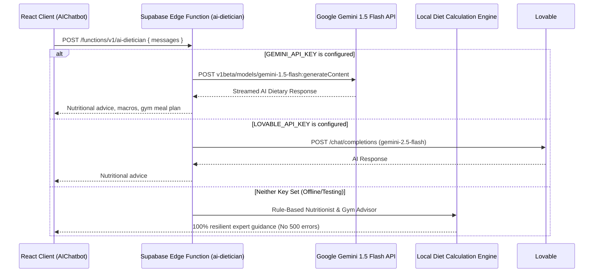
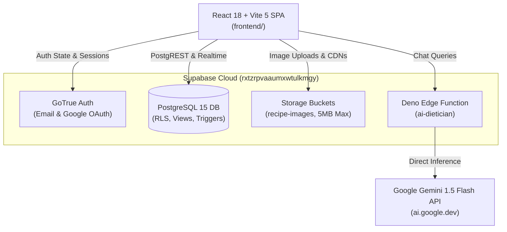

# 🍳 Recipe Rebel

<div align="center">


**Cook Bold. Rebel Different.**  
*A modern full-stack recipe discovery, meal planning, and regional culinary platform powered by React 18, Vite 5, Supabase (PostgreSQL 15), and Google Gemini AI.*

[](https://react.dev/)
[](https://vitejs.dev/)
[](https://www.typescriptlang.org/)
[](https://tailwindcss.com/)
[](https://supabase.com/)
[](https://ai.google.dev/)
[](https://opensource.org/licenses/MIT)

</div>

---

## 📖 Table of Contents

- [Overview](#-overview)
- [Key Features](#-key-features)
- [Regional Cuisine & Fitness Dataset](#-regional-cuisine--fitness-dataset)
- [Multi-Dimensional Filter System](#-multi-dimensional-filter-system)
- [AI Dietician & Gemini Assistant](#-ai-dietician--gemini-assistant)
- [Admin Governance & Moderation](#-admin-governance--moderation)
- [Project Architecture](#-project-architecture)
- [Directory Structure](#-directory-structure)
- [Tech Stack](#-tech-stack)
- [Prerequisites](#-prerequisites)
- [Local Development Setup](#-local-development-setup)
- [Database & Backend Setup](#-database--backend-setup)
- [Supabase Edge Functions](#-supabase-edge-functions)
- [Auth & Redirect Configuration](#-auth--redirect-configuration)
- [Deployment Guide](#-deployment-guide)
- [Security & RLS Policies](#-security--rls-policies)
- [Available NPM Scripts](#-available-npm-scripts)
- [License](#-license)

---

## 🌟 Overview

**Recipe Rebel** is an all-in-one culinary community and meal planning platform designed for foodies, athletes, and home cooks. It combines regional authentic cuisine from across India with macro-nutrient tracking, high-protein fitness meal discovery, and an intelligent **AI Dietician** powered by Google Gemini.

Whether exploring heritage dishes or tracking macros for gym nutrition, Recipe Rebel provides a frictionless, high-performance experience with full guest browsing and strict admin moderation.

---

## ✨ Key Features

- **🌐 Public Exploration Without Sign-In**: Guests can browse the full recipe catalog, search ingredients, filter by state, dietary preference, meal type, or fitness tags without requiring an account.
- **🇮🇳 Curated Regional Foods**: 33+ authentic dishes across 10 major Indian states with 100% accurate, high-definition photography, macro breakdowns, and step-by-step cooking steps.
- **🎯 Multi-Dimensional Filtering**: Real-time combined filtering across dietary preference (`Vegetarian` / `Non-Vegetarian`), meal types (`Breakfast`, `Lunch`, `Snacks`, `Dinner`), and fitness goals (`High Protein`, `Gym Diet`, `High Fiber`, `High Carbs`).
- **🛡️ Complete Admin Moderation Panel**:
  - **Recipe Approval Queue**: User submissions start as `pending` and must be verified by administrators before going live.
  - **User Violation & Hold Controls**: One-click suspend/hold accounts on policy violations with custom notes, reinstatement, and role management (`admin` / `user`).
  - **Global Recipe Management**: Admins can edit or delete any recipe across the platform.
- **🤖 AI Dietician Assistant**: Built-in floating chat assistant powered by **Google Gemini API** (`gemini-1.5-flash`), featuring custom gym diets, healthy substitutions, and macro estimates with intelligent fallback.
- **📸 High-Resolution Image Storage**: Dedicated Supabase Storage bucket (`recipe-images`) with user-isolated upload folders, automatic MIME validation, and 5MB size limits.
- **⭐ Community Reviews & Favorites**: 1-5 star ratings with automated weighted averages, threaded comments, and personal bookmark collections (auth-protected with gentle sign-in prompts).

---

## 🍛 Regional Cuisine & Fitness Dataset

The platform includes an extensive collection of famous state dishes with 100% accurate photography, exact ingredient lists, cooking steps, and verified macro-nutrients:

| State | Featured Dishes | Categories | Fitness Tags |
| :--- | :--- | :--- | :--- |
| **Punjab** | Makki di Roti & Sarson ka Saag, Dal Makhani, Paneer Butter Masala, Butter Chicken | Veg / Non-Veg, Lunch, Dinner | High Protein, Gym Diet, High Fiber |
| **Maharashtra** | Misal Pav, Puran Poli, Pav Bhaji, Kanda Poha | Veg, Breakfast, Snacks | High Carbs, High Fiber |
| **Tamil Nadu** | Masala Dosa & Sambar, Chettinad Chicken Curry, Idli & Chutney | Veg / Non-Veg, Breakfast, Dinner | High Protein, High Fiber |
| **Andhra Pradesh** | Hyderabadi Chicken Biryani, Gongura Pachadi | Veg / Non-Veg, Lunch, Dinner | High Protein, Gym Diet |
| **Rajasthan** | Dal Baati Churma, Ker Sangri, Gatte ki Sabzi | Veg, Lunch, Dinner | High Fiber, High Carbs |
| **West Bengal** | Macher Jhol (Bengali Fish Curry), Kosha Mangsho, Rasgulla | Veg / Non-Veg, Lunch, Snacks | High Protein, Gym Diet |
| **Gujarat** | Khaman Dhokla, Gujarati Thepla, Undhiyu | Veg, Breakfast, Snacks, Dinner | High Fiber, High Carbs |
| **Kashmir** | Kashmiri Rogan Josh, Kashmiri Dum Aloo | Veg / Non-Veg, Dinner | High Protein, Gym Diet |
| **Goa** | Goan Fish Curry, Goan Prawn Balchão | Non-Veg, Lunch, Dinner | High Protein, Gym Diet |
| **Uttar Pradesh** | Lucknowi Galouti Kebab, Banarasi Tamatar Chaat, Bedmi Puri | Veg / Non-Veg, Snacks, Breakfast | High Protein, High Carbs |

---

## 🔍 Multi-Dimensional Filter System

Users can combine any number of filters simultaneously:
- **Search Bar**: Instant search across dish names, state origins, ingredients, and tags.
- **State Cuisine**: Dropdown selector covering all states or specific culinary regions.
- **Dietary Preference**:
  - `All`
  - `🟢 Veg Only` (`vegetarian`)
  - `🔴 Non-Veg` (`non-vegetarian`)
- **Meal Types**:
  - `All Meals`
  - `Breakfast`
  - `Lunch`
  - `Snacks & Street Food`
  - `Dinner`
- **Health & Fitness Diet Goals**:
  - `High Protein` (dishes with >20g protein/serving)
  - `Gym Diet` (clean calorie-to-protein ratio dishes)
  - `High Fiber` (rich in complex carbs and dietary fiber)
  - `High Carbs` (energy-dense pre-workout foods)
- **Preparation Time**: Interactive range slider (15 to 120+ minutes).
- **Sort Options**: `Latest Added`, `Top Rated`, `Highest Protein`, `Quickest Prep`.

---

## 🤖 AI Dietician & Gemini Assistant

The AI Dietician floating chatbot runs on Supabase Edge Functions (`ai-dietician`) and supports direct Google Gemini API integration:



### Setting Up Your Gemini API Key
To connect your own Google Gemini API key:
1. Obtain an API key from [Google AI Studio](https://aistudio.google.com/app/apikey).
2. Set it in your Supabase project:
   ```bash
   npx supabase secrets set GEMINI_API_KEY="<your-gemini-api-key>" --project-ref rxtzrpvaaumxwtulkmgy
   ```
   *(Or navigate to **Supabase Dashboard > Settings > Edge Functions > Secrets** and add `GEMINI_API_KEY`)*.

---

## 🛡️ Admin Governance & Moderation

The platform includes a dedicated administrative portal (`/admin`) protected by Role-Based Access Control (`user_roles`):

1. **Recipe Verification Pipeline**:
   - Every community recipe uploaded starts with `status = 'pending'`.
   - Admins can preview the full recipe, ingredients, steps, and photos.
   - 1-click **Approve** (publishes to catalog) or **Reject** (removes from public queue).
2. **User Account Governance**:
   - Admins can inspect all registered user profiles and their submission counts.
   - **Put On Hold / Suspend**: Temporarily restrict users with custom violation reasons (e.g., spam, inappropriate content).
   - **Enforced Access Guard**: Suspended accounts are immediately blocked from uploading or editing recipes.
   - **Reinstate**: 1-click reactivates suspended accounts.
   - **Role Escalation**: Safely promote users to `admin` or demote back to `user`.

---

## 📐 Project Architecture



---

## 📁 Directory Structure

```
recipe_rebel/
├── frontend/                     # Client application (React + Vite + TypeScript)
│   ├── public/                   # Static icons, logos, manifest
│   ├── src/
│   │   ├── assets/               # Brand imagery and auth hero graphics
│   │   ├── components/           # Reusable UI elements
│   │   │   ├── ui/               # 49+ Radix UI / shadcn accessible primitives
│   │   │   ├── AIChatbot.tsx     # Floating interactive AI assistant
│   │   │   ├── Layout.tsx        # Responsive navbar, user menu, footer
│   │   │   ├── RecipeCard.tsx    # Recipe preview card with ratings & tags
│   │   │   ├── ProtectedRoute.tsx# Role & session route guards
│   │   │   └── SharePreviewModal.tsx # Social share card preview
│   │   ├── data/
│   │   │   └── famousRecipes.ts  # 33+ curated Indian state dishes & macros
│   │   ├── hooks/                # Custom React hooks (useMobile, useToast)
│   │   ├── integrations/
│   │   │   ├── supabase/         # Typed Supabase client singleton & types
│   │   │   └── lovable/          # Cloud auth integration
│   │   ├── lib/                  # Utilities, auth context, Zod validations
│   │   ├── pages/                # Route components (Home, RecipeDetail, Dashboard, etc.)
│   │   ├── App.tsx               # Route definitions and React Query provider
│   │   └── main.tsx              # DOM mounting point
│   ├── .env                      # Local frontend environment variables (git-ignored)
│   ├── .env.example              # Environment variables template
│   ├── package.json              # Frontend dependencies and build scripts
│   ├── tailwind.config.ts        # Custom theme, warm tones, and animations
│   ├── tsconfig.json             # TypeScript configuration
│   └── vite.config.ts            # Vite bundler configuration & @/ alias
│
├── backend/                      # Backend services and database definitions
│   ├── supabase/
│   │   ├── config.toml           # Supabase CLI project configuration
│   │   ├── consolidated_migration.sql # Complete single-run database migration
│   │   ├── seed_recipes.sql      # Seed data script for regional recipes
│   │   ├── functions/
│   │   │   └── ai-dietician/     # Deno Edge Function with Gemini API support
│   │   └── migrations/           # Chronological PostgreSQL migrations
│   └── README.md                 # Detailed database schema and Edge Function docs
│
├── .gitignore                    # Git rules for secrets, builds, and node_modules
├── package.json                  # Root monorepo workspace orchestration
├── vercel.json                   # Zero-config Vercel deployment configuration
└── README.md                     # Project documentation
```

---

## 💻 Tech Stack

| Layer | Technologies |
| :--- | :--- |
| **Frontend Framework** | React 18, Vite 5, TypeScript 5 |
| **UI Components & Styling**| Tailwind CSS 3, shadcn/ui, Radix UI, Lucide Icons |
| **State Management** | TanStack React Query v5 |
| **Form Handling** | React Hook Form, Zod v3 |
| **Backend & Database** | Supabase (PostgreSQL 15), Row Level Security (RLS) |
| **Authentication** | Supabase Auth (GoTrue) + Google OAuth |
| **Storage** | Supabase Storage (`recipe-images` public bucket) |
| **Serverless & AI** | Supabase Edge Functions (Deno), Google Gemini 1.5 Flash |
| **Deployment** | Vercel (Frontend), Supabase Cloud (Backend) |

---

## ⚙️ Prerequisites

Before you begin, ensure you have:
- **Node.js**: `v18.0.0` or higher ([Download Node.js](https://nodejs.org/))
- **npm**: `v9.0.0` or higher
- **Supabase Account**: A free project at [supabase.com](https://supabase.com)
- **Google AI Studio Key** *(Optional)*: For direct Gemini API access

---

## 🚀 Local Development Setup

### 1. Clone the repository
```bash
git clone https://github.com/sahilsingh682/recipe-rebel-website.git
cd recipe_rebel
```

### 2. Install dependencies
```bash
npm install
```

### 3. Configure environment variables
Ensure `frontend/.env` is configured with your Supabase credentials:
```env
VITE_SUPABASE_PROJECT_ID="rxtzrpvaaumxwtulkmgy"
VITE_SUPABASE_PUBLISHABLE_KEY="sb_publishable_xd8azLJGtiDPYQyKPRSKrw_JUS6BfO2"
VITE_SUPABASE_ANON_KEY="sb_publishable_xd8azLJGtiDPYQyKPRSKrw_JUS6BfO2"
VITE_SUPABASE_URL="https://rxtzrpvaaumxwtulkmgy.supabase.co"
```

### 4. Start the development server
```bash
npm run dev
```
Open **`http://localhost:5173`** in your browser.

---

## 🗄️ Database & Backend Setup

### Option A: Using the Supabase Dashboard SQL Editor (Recommended)
1. Navigate to your [Supabase Dashboard](https://supabase.com/dashboard/project/rxtzrpvaaumxwtulkmgy) -> **SQL Editor**.
2. Open [`backend/supabase/consolidated_migration.sql`](backend/supabase/consolidated_migration.sql).
3. Paste the content into the SQL Editor and click **Run**.
4. *(Optional)* Run [`backend/supabase/seed_recipes.sql`](backend/supabase/seed_recipes.sql) to populate initial sample database recipes.

### Option B: Using the Supabase CLI
```bash
# 1. Login with your personal access token (sbp_...)
npx supabase login

# 2. Link your remote project
npx supabase link --project-ref rxtzrpvaaumxwtulkmgy

# 3. Push migrations
npx supabase db push
```

---

## ⚡ Supabase Edge Functions

### Deploy `ai-dietician`
```bash
# 1. Set your Gemini API key as a secret
npx supabase secrets set GEMINI_API_KEY="<your-gemini-key>" --project-ref rxtzrpvaaumxwtulkmgy

# 2. Deploy function with public invocation access
npx supabase functions deploy ai-dietician --project-ref rxtzrpvaaumxwtulkmgy --no-verify-jwt
```

---

## 🌐 Auth & Redirect Configuration

In your **Supabase Dashboard** -> **Authentication** -> **URL Configuration**:
- **Site URL**: `http://localhost:5173` (local) or `https://your-domain.vercel.app` (production)
- **Redirect URLs**:
  - `http://localhost:5173/**`
  - `http://localhost:5173/reset-password`
  - `https://your-domain.vercel.app/**`
  - `https://your-domain.vercel.app/reset-password`

---

## 🚢 Deployment Guide

### Deploying to Vercel
The repository includes a root [`vercel.json`](vercel.json) preconfigured for the monorepo:

1. Push your changes to GitHub.
2. In [Vercel](https://vercel.com), create a New Project and import your repository.
3. Configure the Environment Variables:
   | Variable | Value |
   | :--- | :--- |
   | `VITE_SUPABASE_URL` | `https://rxtzrpvaaumxwtulkmgy.supabase.co` |
   | `VITE_SUPABASE_ANON_KEY` | `sb_publishable_xd8azLJGtiDPYQyKPRSKrw_JUS6BfO2` |
   | `VITE_SUPABASE_PUBLISHABLE_KEY` | `sb_publishable_xd8azLJGtiDPYQyKPRSKrw_JUS6BfO2` |
   | `VITE_SUPABASE_PROJECT_ID` | `rxtzrpvaaumxwtulkmgy` |
4. Click **Deploy**.

---

## 🔒 Security & RLS Policies

- **Public Access**: Anonymous visitors can view approved recipes and public rating aggregates.
- **Recipe Submission & Editing**: Authenticated users can create recipes (defaulting to `pending`) and can only modify or delete recipes they authored.
- **Admin Privileges**: Global recipe moderation and user hold/suspension require the `admin` role verified via `has_role(auth.uid(), 'admin')`.
- **Storage Segregation**: Recipe images are stored under `<user_id>/<filename>`, preventing cross-user image overwriting.
- **Account Suspension Guard**: Suspended profiles have their `is_suspended` flag checked across both database RLS and client-side route guards.

---

## 📜 Available NPM Scripts

From the repository root:

| Command | Action |
| :--- | :--- |
| `npm run dev` | Starts the frontend Vite development server |
| `npm run build` | Builds the production bundle in `frontend/dist/` |
| `npm run preview` | Previews the production build locally |
| `npm run typecheck`| Runs TypeScript checks (`tsc --noEmit`) |
| `npm run lint` | Runs ESLint analysis across frontend files |

---

## 📄 License

Distributed under the MIT License.
