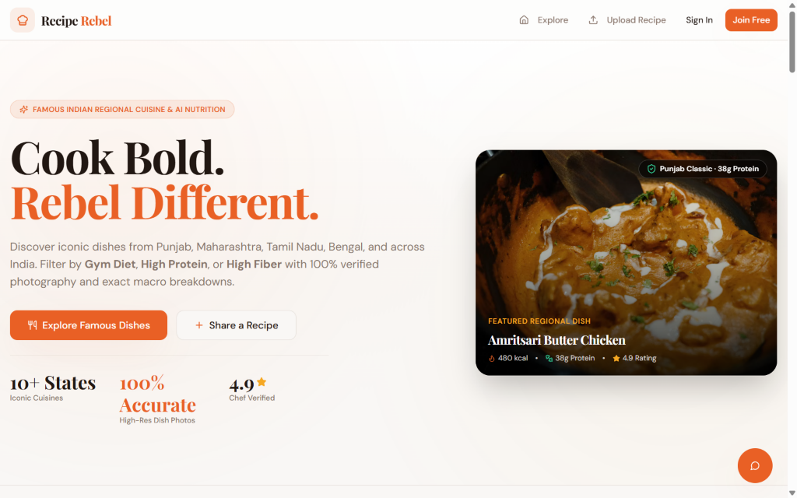
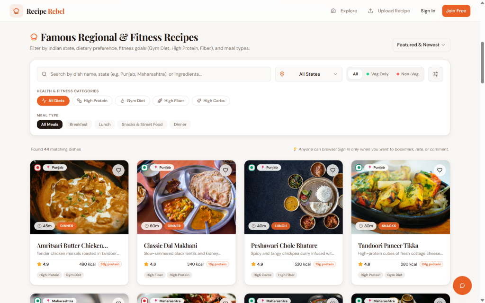
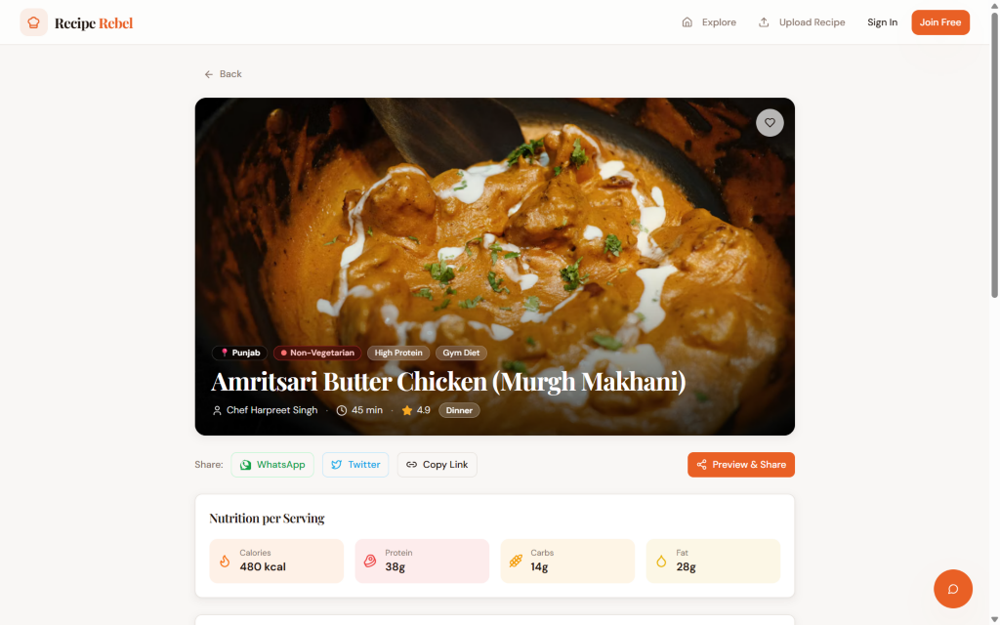
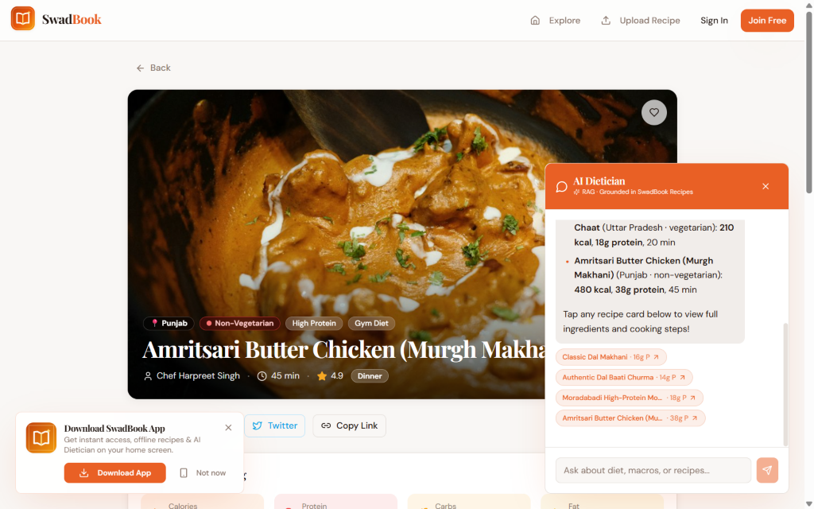
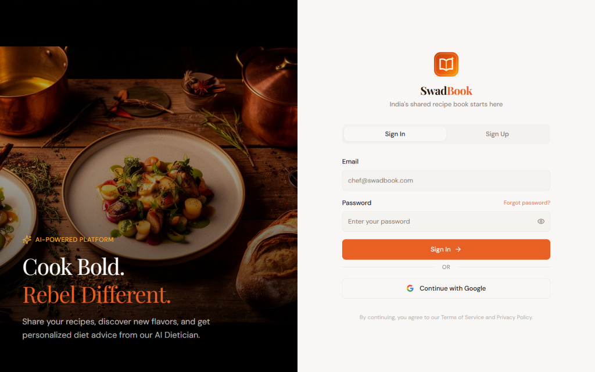
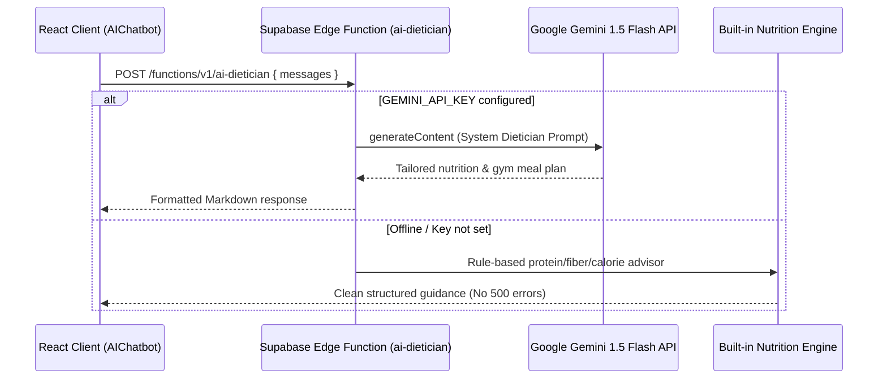
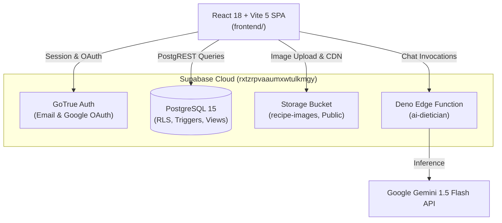

<div align="center">

# 🍲 Zaika

### **Bold Flavors. Smart Macros.**
*A full-stack regional culinary discovery, macro-nutrition tracking, PWA-enabled, and AI-powered meal planning platform built with React 18, Vite 5, Supabase (PostgreSQL 15), and Google Gemini.*

[](https://reciperebel.vercel.app)
[](https://react.dev/)
[](https://www.typescriptlang.org/)
[](https://supabase.com/)
[](https://ai.google.dev/)

<br />



</div>

---

## 📸 Platform Showcase

<table>
  <tr>
    <td width="50%" align="center">
      <b>🔍 Multi-Dimensional Filters & Regional Dishes</b><br /><br />
      
      <br /><sub>Filter by State, Veg/Non-Veg, Meal Type, Prep Time, and Fitness Goals.</sub>
    </td>
    <td width="50%" align="center">
      <b>🍽️ Detailed Recipe, Macros & Step-by-Step Guide</b><br /><br />
      
      <br /><sub>Full nutritional breakdown, ingredients checklist, ratings, and comments.</sub>
    </td>
  </tr>
  <tr>
    <td width="50%" align="center">
      <b>🤖 AI Dietician Chatbot (Google Gemini)</b><br /><br />
      
      <br /><sub>Personalized gym diets, calorie targets, and macro advice in real time.</sub>
    </td>
    <td width="50%" align="center">
      <b>🔐 Split-Screen Auth & Native Google OAuth</b><br /><br />
      
      <br /><sub>Email/Password, Password Reset, and native Supabase Google Sign-In.</sub>
    </td>
  </tr>
</table>

---

## 📖 Table of Contents

- [Overview](#-overview)
- [Key Features](#-key-features)
- [Regional Cuisine & Fitness Dataset](#-regional-cuisine--fitness-dataset)
- [Multi-Dimensional Filter System](#-multi-dimensional-filter-system)
- [AI Dietician Architecture](#-ai-dietician-architecture)
- [Admin Governance & Moderation](#-admin-governance--moderation)
- [System Architecture](#-system-architecture)
- [Directory Structure](#-directory-structure)
- [Tech Stack](#-tech-stack)
- [Local Development Setup](#-local-development-setup)
- [Database & Storage Setup](#-database--storage-setup)
- [Deployment & Environment Variables](#-deployment--environment-variables)
- [Security & RLS](#-security--rls)
- [License](#-license)

---

## 🌟 Overview

**Zaika** bridges authentic regional Indian cuisine with modern fitness nutrition. Guests can explore curated state dishes, inspect macro profiles, install the app as a **Progressive Web App (PWA)**, and consult the floating **AI Dietician** without creating an account — while registered users can upload recipes, leave star ratings and comments, save favorites, and manage their culinary dashboard. Administrators moderate submissions and enforce community guidelines from a dedicated `/admin` console.

---

## ✨ Key Features

- **🌐 Frictionless Guest Browsing**: Full public access to the landing page, recipe catalog, search, multi-filters, and AI Dietician — sign-in is only prompted for commenting, rating, saving favorites, or uploading recipes.
- **🇮🇳 Curated Regional Foods**: 22+ authentic dishes across 10 Indian states with high-resolution imagery hosted in Supabase Storage (`recipe-images`), exact ingredients, steps, and verified macros.
- **🎯 Multi-Dimensional Filtering**: Combine **State**, **Veg / Non-Veg**, **Meal Type** (`Breakfast`, `Lunch`, `Snacks`, `Dinner`), **Fitness Goals** (`High Protein`, `Gym Diet`, `High Fiber`, `High Carbs`), **Prep Time**, and **Sort Order** simultaneously.
- **🤖 AI Dietician Assistant**: Floating chatbot powered by Supabase Edge Functions (`ai-dietician`) with direct **Google Gemini API** (`gemini-1.5-flash`) integration, rich Markdown formatting, and a built-in fallback nutrition engine.
- **🛡️ Dedicated Admin Console (`/admin`)**:
  - **Recipe Verification Queue**: New user submissions start as `pending` until approved by an admin.
  - **User Governance & Hold System**: Suspend/hold accounts with custom violation reasons, reinstate users, or manage `admin` / `user` roles.
- **🔐 Native Supabase Auth**: Email/Password sign-up & login, self-service password reset, and native **Google OAuth** (`supabase.auth.signInWithOAuth`).

---

## 🍛 Regional Cuisine & Fitness Dataset

| State | Featured Dishes | Dietary & Meal Types | Fitness Tags |
| :--- | :--- | :--- | :--- |
| **Punjab** | Amritsari Butter Chicken, Classic Dal Makhani, Tandoori Paneer Tikka, Sarson ka Saag & Makki Roti | Veg / Non-Veg · Snacks, Lunch, Dinner | `high-protein`, `gym-diet`, `high-fiber` |
| **Maharashtra** | Mumbai Vada Pav, Kolhapuri Misal Pav, Kanda Poha, Sabudana Khichdi | Veg · Breakfast, Snacks | `high-carbs`, `high-fiber` |
| **Tamil Nadu** | Crispy Masala Dosa, Chettinad Chicken Curry, Steamed Idli & Sambar | Veg / Non-Veg · Breakfast, Dinner | `high-protein`, `high-fiber` |
| **Andhra Pradesh** | Hyderabadi Chicken Biryani, Pesarattu (Green Moong Dosa) | Veg / Non-Veg · Breakfast, Lunch | `high-protein`, `gym-diet` |
| **Rajasthan** | Dal Baati Churma, Ker Sangri | Veg · Lunch, Dinner | `high-fiber`, `high-carbs` |
| **West Bengal** | Macher Jhol (Bengali Fish Curry), Kosha Mangsho | Non-Veg · Lunch, Dinner | `high-protein`, `gym-diet` |
| **Gujarat** | Khaman Dhokla, Methi Thepla | Veg · Breakfast, Snacks | `high-fiber`, `high-carbs` |
| **Kashmir** | Kashmiri Rogan Josh | Non-Veg · Dinner | `high-protein`, `gym-diet` |
| **Goa** | Goan Fish Curry | Non-Veg · Lunch | `high-protein`, `gym-diet` |
| **Uttar Pradesh** | Lucknowi Tunday Galouti Kebab | Non-Veg · Snacks | `high-protein`, `gym-diet` |

---

## 🔍 Multi-Dimensional Filter System

- **Instant Search**: Matches dish titles, states, ingredients, and tags.
- **Regional State Selector**: Filter by any state or browse `All States`.
- **Dietary Toggle**: `All`, `🟢 Veg Only`, `🔴 Non-Veg`.
- **Meal Type Pills**: `All Meals`, `Breakfast`, `Lunch`, `Snacks & Street Food`, `Dinner`.
- **Health & Fitness Goals**: `High Protein`, `Gym Diet`, `High Fiber`, `High Carbs`.
- **Preparation Time Slider**: Filter dishes from 15 to 120+ minutes.
- **Sorting**: `Latest Added`, `Top Rated`, `Highest Protein`, `Quickest Prep`.

---

## 🤖 AI Dietician Architecture



### Deploy & Configure Gemini Secret
```bash
npx supabase secrets set GEMINI_API_KEY="<your-gemini-api-key>" --project-ref rxtzrpvaaumxwtulkmgy
npx supabase functions deploy ai-dietician --project-ref rxtzrpvaaumxwtulkmgy --no-verify-jwt
```

---

## 🛡️ Admin Governance & Moderation

1. **Recipe Verification Pipeline**: Community-submitted recipes default to `status = 'pending'`. Admins inspect ingredients, steps, and photos in `/admin` before clicking **Approve** or **Reject**.
2. **User Account Governance**: Admins can place accounts on **Hold / Suspend** with violation reasons (blocking uploads, edits, ratings, and comments), reinstate accounts, or assign `admin` roles.
3. **Human-Readable `user_roles` Table**: Includes `short_id`, `short_user_id` (`USR-XXXXXXXX`), `user_name`, and `user_email` alongside `user_id` for effortless management in Supabase.

---

## 📐 System Architecture



---

## 📁 Directory Structure

```
recipe_rebel/
├── docs/
│   └── screenshots/              # Website UI screenshots used in documentation
├── frontend/                     # Client SPA (React + Vite + TypeScript)
│   ├── src/
│   │   ├── components/           # Layout, RecipeCard, AIChatbot, AuthPromptDialog, ui/
│   │   ├── data/                 # famousRecipes.ts (curated regional dishes)
│   │   ├── integrations/         # Supabase client singleton & generated types
│   │   ├── lib/                  # AuthContext, Zod validations, utilities
│   │   └── pages/                # Home, Auth, RecipeDetail, UploadRecipe, Dashboard, AdminDashboard
│   ├── .env.example              # Frontend environment template
│   └── package.json
├── backend/                      # Database & Serverless Backend
│   ├── supabase/
│   │   ├── config.toml
│   │   ├── consolidated_migration.sql  # Complete schema, RLS, triggers, storage
│   │   ├── seed_recipes.sql      # Schema alignment + 22 regional dishes seed
│   │   ├── functions/ai-dietician/
│   │   └── migrations/           # Chronological PostgreSQL migrations
│   └── README.md
├── package.json                  # Root monorepo workspace scripts
├── vercel.json                   # Vercel monorepo build & SPA rewrite config
└── README.md
```

---

## 💻 Tech Stack

| Layer | Technologies |
| :--- | :--- |
| **Frontend** | React 18, Vite 5, TypeScript 5, Tailwind CSS 3, shadcn/ui, Radix UI, Lucide Icons |
| **State & Forms** | TanStack React Query v5, React Hook Form, Zod v3, Sonner |
| **Backend & DB** | Supabase (PostgreSQL 15), Row Level Security (RLS), Triggers & Views |
| **Auth & Storage** | Supabase Auth (Email + Native Google OAuth), Supabase Storage (`recipe-images`) |
| **AI & Serverless** | Supabase Edge Functions (Deno), Google Gemini 1.5 Flash |
| **Hosting** | Vercel (Frontend), Supabase Cloud (Backend) |

---

## 🚀 Local Development Setup

```bash
# 1. Clone the repository
git clone https://github.com/sahilsingh682/reciperebel.git
cd reciperebel

# 2. Install dependencies
npm install

# 3. Configure frontend/.env
cp .env.example frontend/.env
# Add your VITE_SUPABASE_URL and VITE_SUPABASE_ANON_KEY

# 4. Start development server (http://localhost:5173)
npm run dev
```

### Root NPM Scripts

| Command | Description |
| :--- | :--- |
| `npm run dev` | Start Vite frontend development server |
| `npm run build` | Build production bundle into `frontend/dist/` |
| `npm run preview` | Preview production build locally |
| `npm run typecheck` | Run TypeScript compiler check (`tsc --noEmit`) |
| `npm run lint` | Run ESLint across frontend files |

---

## 🗄️ Database & Storage Setup

Run these scripts in order inside **Supabase Dashboard → SQL Editor**:
1. [`backend/supabase/consolidated_migration.sql`](backend/supabase/consolidated_migration.sql) — Creates tables (`profiles`, `user_roles`, `recipes`, `comments`, `ratings`, `favorites`), triggers, RLS policies, and the `recipe-images` storage bucket.
2. [`backend/supabase/seed_recipes.sql`](backend/supabase/seed_recipes.sql) — Aligns schema columns and seeds all 22 curated regional recipes linked to `recipe-images/curated/*.jpg`.
3. *(Optional)* Grant admin access to your account:
   ```sql
   UPDATE public.user_roles SET role = 'admin' WHERE user_email = 'your-email@example.com';
   ```

---

## 🚢 Deployment & Environment Variables

### Vercel Environment Variables
Add these public variables in **Vercel → Project Settings → Environment Variables**:

| Key | Value |
| :--- | :--- |
| `VITE_SUPABASE_URL` | `https://<your-project-ref>.supabase.co` |
| `VITE_SUPABASE_ANON_KEY` | `<your-supabase-anon-or-publishable-key>` |
| `VITE_SUPABASE_PUBLISHABLE_KEY` | `<your-supabase-anon-or-publishable-key>` |
| `VITE_SUPABASE_PROJECT_ID` | `<your-project-ref>` |

> **Note**: Never expose `sb_secret_...` or `GEMINI_API_KEY` in `VITE_*` variables. Keep `GEMINI_API_KEY` inside **Supabase Dashboard → Edge Functions → Secrets**.

### Auth Redirect URLs
In **Supabase Dashboard → Authentication → URL Configuration**, add:
- `http://localhost:5173/**`
- `https://reciperebel.vercel.app/**`
- `https://reciperebel.vercel.app/reset-password`

---

## 🔒 Security & RLS

- **Row Level Security**: Enabled on all tables; public visitors only see `approved` recipes and `public_ratings`.
- **Role Isolation**: Admin checks use `has_role(auth.uid(), 'admin')` (`SECURITY DEFINER`).
- **Storage Isolation**: `recipe-images` restricts writes to authenticated users inside their own `<user_id>/` folder (5 MB max, image MIME whitelist).

---

## 📄 License

Distributed under the MIT License.
